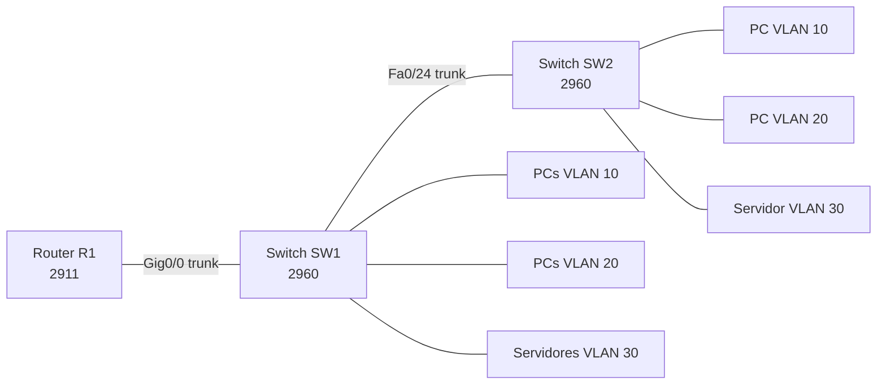

<div align="center">

# Network Lab — VLANs e Inter-VLAN Routing

**Laboratorio de redes con Cisco Packet Tracer: VLANs, trunks, router-on-a-stick, DHCP y ACLs.**


</div>

## Descripción

Laboratorio reproducible de segmentación de red con VLANs e inter-VLAN routing. El objetivo es mostrar una topología pequeña pero completa: creación de VLANs, puertos de acceso, enlaces troncales, subinterfaces en un router, direccionamiento IP, DHCP, administración remota y una ACL de ejemplo.

La configuración se documenta en archivos de texto y se puede construir en Cisco Packet Tracer. El archivo binario `.pkt` se guarda en `topology/` después de exportarlo desde Packet Tracer.

## Topología



## VLANs y direccionamiento

| VLAN | Nombre | Subred | Gateway | Uso |
| --- | --- | --- | --- | --- |
| 10 | ADMINISTRACION | 10.10.10.0/24 | 10.10.10.1 | Equipos administrativos |
| 20 | USUARIOS | 10.20.20.0/24 | 10.20.20.1 | Estaciones de trabajo |
| 30 | SERVIDORES | 10.30.30.0/24 | 10.30.30.1 | Servicios internos |
| 99 | GESTION | 10.99.99.0/24 | 10.99.99.1 | Administración de switches |

Detalles completos: [docs/addressing.md](docs/addressing.md).

## Dispositivos

| Dispositivo | Rol |
| --- | --- |
| `R1` | Router 2911 con subinterfaces y DHCP |
| `SW1` | Switch principal con VLANs, trunks y puertos de acceso |
| `SW2` | Switch secundario conectado por trunk |
| `PC-A1`, `PC-A2`, `PC-A3` | Clientes VLAN 10 |
| `PC-U1`, `PC-U2`, `PC-U3` | Clientes VLAN 20 |
| `SRV1`, `SRV2`, `SRV3` | Servidores VLAN 30 |

## Configuración

Las configuraciones de referencia están en [configs/](configs/):

- [configs/router.txt](configs/router.txt)
- [configs/switch1.txt](configs/switch1.txt)
- [configs/switch2.txt](configs/switch2.txt)

## Puesta en marcha en Packet Tracer

1. Abre Packet Tracer y crea la topología descrita en [docs/topology.md](docs/topology.md).
2. Asigna IPs estáticas a los servidores y a los switches de gestión.
3. Configura los switches con `configs/switch1.txt` y `configs/switch2.txt`.
4. Configura el router con `configs/router.txt`.
5. Configura los PCs para obtener IP por DHCP, excepto los que tengan IP estática documentada.
6. Guarda el archivo como `topology/network-lab-vlan.pkt`.
7. Ejecuta las verificaciones de [docs/verification.md](docs/verification.md).

## Verificación

Ejemplos de comandos de validación:

```text
show vlan brief
show interfaces trunk
show ip interface brief
show ip route
show ip dhcp binding
show access-lists
ping 10.30.30.11
```

La lista completa está en [docs/verification.md](docs/verification.md).

## Decisiones técnicas

- **Router-on-a-stick:** un solo router con subinterfaces permite inter-VLAN routing sin hardware adicional.
- **VLAN de gestión separada:** la administración de switches no comparte subred con usuarios.
- **DHCP por VLAN:** cada VLAN recibe su propio pool y gateway.
- **ACL de ejemplo:** los usuarios pueden acceder a servicios web y DNS de servidores, pero no a la VLAN de administración.
- **Trunks explícitos:** se limitan las VLAN permitidas en cada enlace troncal.

## Limitaciones

- Packet Tracer no se puede generar ni validar desde la línea de comandos en este entorno.
- El archivo `.pkt` debe crearse y exportarse manualmente desde Packet Tracer.
- Las configuraciones son de laboratorio y no incluyen alta disponibilidad, redundancia de enlaces ni monitoreo.
- No se configura NAT ni acceso a Internet.

## Materias que respalda

- Redes I.
- Sistemas Operativos en Red.
- Soporte Técnico y Operaciones.
- Administración de Redes.

## Autor

**Francisco Javier Peraza** · [GitHub](https://github.com/CodigoPeraza) · [contacto.peraza@gmail.com](mailto:contacto.peraza@gmail.com)
